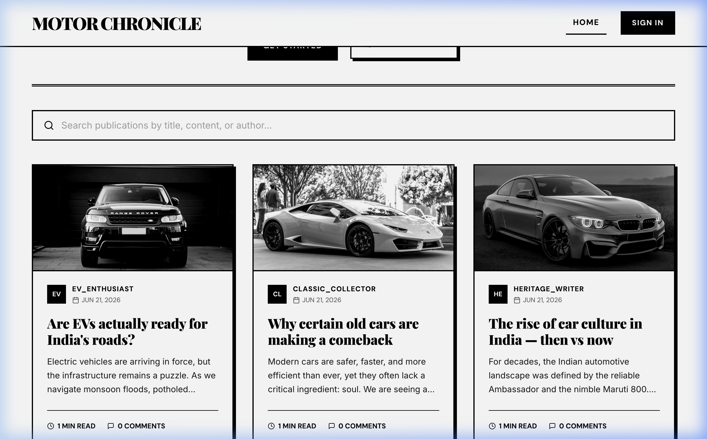
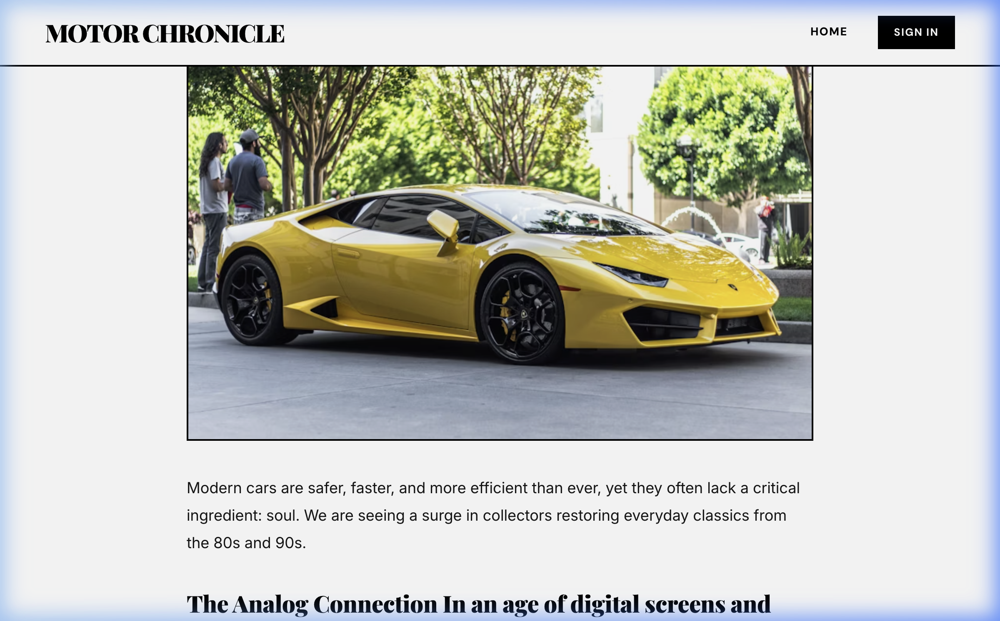
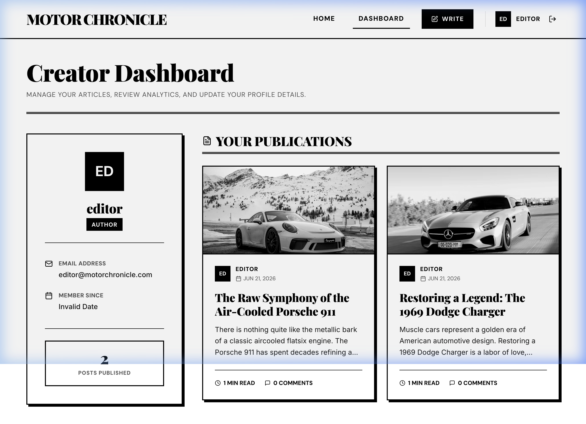

# Motor Chronicle

> **Motor Chronicle** is a modern, high-contrast, black-and-white editorial blogging platform dedicated to car culture, classic restorations, motorsport heritage, and modern automotive engineering. 

The design is heavily inspired by the classic flat newsprint aesthetic of **Rolling Stone** magazine, featuring serif typography, solid double-border separators, and flat offset shadows.

---

## 📸 Visual Previews

### 1. Editorial Homepage Feed (Strictly B&W)
Card images remain strictly black-and-white in the grid, maintaining the newspaper theme.


### 2. Article Details Page (Color Reveal)
Clicking into an article reveals the cover image in vibrant full color.


### 3. Creator Dashboard & Publications
Manage your published articles and check your stats from a clean, high-contrast dashboard.


---

## ⚡ Key Features

1.  **User Authentication & Security**:
    *   Secure registration, login, and token-based authentication using **JWT** and **bcryptjs** password hashing.
    *   Auth context wrapper protects write and edit actions, automatically routing non-logged-in users.
2.  **Post Management (CRUD)**:
    *   Create, view, update, and delete car posts with title, body, and custom cover images.
    *   Unified tabbed editor: **Write** tab (with live word/character counters) and **Preview** tab (with live draft layout rendering).
3.  **Color Reveal Transition**:
    *   All article cover images remain in high-contrast grayscale on the feed. Once clicked, the article details view loads the image in **full color**.
4.  **Discussion Section**:
    *   Comment feed attached to each article.
    *   Comments can be deleted by the comment author or the post author.
    *   Database uses cascade delete rules (deleting a post automatically wipes all associated comments).
5.  **Local Seeding**:
    *   On the very first startup, the database automatically seeds **6 distinct car bloggers** and their articles.

---

## 🛠️ Technology Stack

*   **Backend**: Node.js, Express, SQLite (zero-config local database), JSON Web Tokens (`jsonwebtoken`), Bcrypt (`bcryptjs`).
*   **Frontend**: React (Vite SPA template), Vanilla CSS (custom variables design system), Lucide React (icons), React Router v7.

---

## 🚀 Getting Started

### Prerequisites
*   Node.js (v18 or higher)
*   npm

### Installation

1. Clone this repository to your local machine.
2. From the root directory, run the installer script to install root, backend, and frontend dependencies:
   ```bash
   npm run install-all
   ```

### Running Locally (Development Mode)

Start both the backend server (on port `5001`) and the frontend Vite dev server (on port `5173`) concurrently:
```bash
npm run dev
```

*   **Frontend Access**: Open [http://localhost:5173](http://localhost:5173) in your browser.
*   **Backend API**: Running at [http://localhost:5001/api](http://localhost:5001/api).

---

## 🔑 Seeded Accounts (For Testing)

The database comes pre-seeded with 6 car bloggers. You can log in to write posts using the following credentials:

*   **Editor-in-Chief**:
    *   *Email*: `editor@motorchronicle.com`
    *   *Password*: `Password123!`
*   **EV Expert**:
    *   *Email*: `ev@motorchronicle.com`
    *   *Password*: `Password123!`
*   **Classic Restorer**:
    *   *Email*: `collector@motorchronicle.com`
    *   *Password*: `Password123!`
*   **Road Tripper**:
    *   *Email*: `trips@motorchronicle.com`
    *   *Password*: `Password123!`

*(Note: All seeded accounts use the same testing password `Password123!`)*
